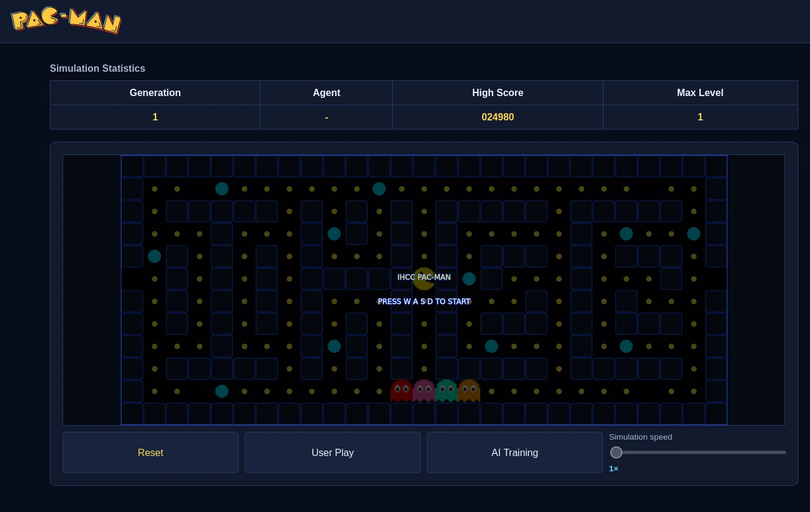

# LU08 - Genetic Algorithm

```
'########:::::'###:::::'######:::::::::::'##::::'##::::'###::::'##::: ##:
 ##.... ##:::'## ##:::'##... ##:::::::::: ###::'###:::'## ##::: ###:: ##:
 ##:::: ##::'##:. ##:: ##:::..::::::::::: ####'####::'##:. ##:: ####: ##:
 ########::'##:::. ##: ##:::::::'#######: ## ### ##:'##:::. ##: ## ## ##:
 ##.....::: #########: ##:::::::........: ##. #: ##: #########: ##. ####:
 ##:::::::: ##.... ##: ##::: ##:::::::::: ##:.:: ##: ##.... ##: ##:. ###:
 ##:::::::: ##:::: ##:. ######::::::::::: ##:::: ##: ##:::: ##: ##::. ##:
..:::::::::..:::::..:::......::::::::::::..:::::..::..:::::..::..::::..::
```

> Learning Outcome: Reinforce using Git and optimizing genetic algorithms.

This project is a clone of the classic game Pac-Man built with [p5.js](https://p5js.org/).
The ghost can be controlled by a player or a genetic algorithm.
The goal of this project is to optimize the performance of the AI controlling the ghost using a genetic algorithm.



## What Do I Do?

- Fork this repository to your own GitHub account.
- Clone **your forked repository** to your local machine.
- Adjust the settings in [`js/AISettings.js`](js/AISettings.js) to experiment with the AI's
  performance.
- Add, Commit, and Push your changes to your forked repository.

```bash
## Clone Down YOUR forked repository
git clone <YOUR_FORKED_REPO_URL>
## After your changes, add, commit, and push your changes
git add .
git commit -m "Your commit message"
git push
```

## What to Turn in?

- A link to **your GitHub repository** containing your code and assets.
- A screenshot of your AI's highest score in the game.
